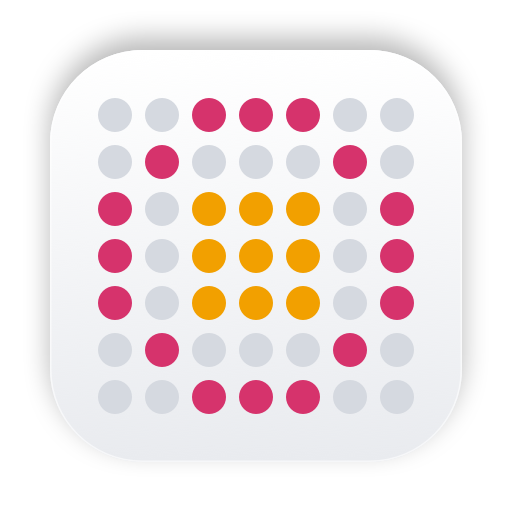

<h1 align="center">
  <picture>
    <source media="(prefers-color-scheme: dark)" srcset="docs/icon-dark.png"/>
    
  </picture>
  Nucli
</h1>

### Nucli is a native macOS agents-first terminal. It launches the agent CLIs you already use in real terminal tabs and conveniently organizes them.

## Features

- Swift and AppKit only: no Electron, no web views, no telemetry
- Projects and workspaces with any number of agent and shell tabs
- Automatic agent detection with live status and resumable conversations
- Smart contextual keybindings and UI with modern window and pane management

## Installing

1. Download `Nucli.dmg` from [Releases](https://github.com/denipolis/nucli/releases)
2. Open it and drag `Nucli.app` to `Applications`
3. Builds are not notarized, so run `xattr -dr com.apple.quarantine /Applications/Nucli.app` once

## Building

Requires macOS 14 or newer to run, Xcode 26 to build.

1. `git clone https://github.com/denipolis/nucli.git`
2. `cd nucli`
3. `./scripts/bundle.sh`
4. `open build/Nucli.app`

## License

[MIT](LICENSE). Nucli is not affiliated with Anthropic, OpenAI or any other agent vendor. Agent names are trademarks of their owners.
