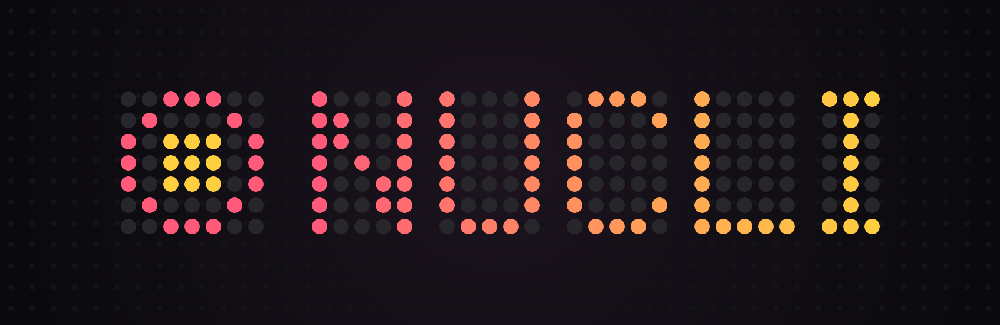

  

### Nucli is an agents-first terminal for macOS, Linux and Windows. It launches the agent CLIs you already use in real terminal tabs and organizes them by project.

## Features

- Projects and workspaces with any number of agent and shell tabs, split panes and a terminal panel per project
- Automatic agent detection with live status, notifications and resumable conversations
- Review what agents change: live git diffs, staging, commits, a commit graph, and a file view you can edit in place
- A fast square monospace UI in Rust, with themes, tree-sitter highlighting and a command palette for everything
- Settings and keybindings are plain JSON files
- No telemetry, no network calls

## Installing

Download the build for your system from [Releases](https://github.com/denipolis/nucli/releases).

- **macOS**: open `Nucli-*.dmg` and drag `Nucli.app` to `Applications`. Builds are not notarized, so run `xattr -dr com.apple.quarantine /Applications/Nucli.app` once.
- **Linux**: unpack `nucli-*.tar.gz` and run `nucli`. It needs Vulkan drivers.
- **Windows**: unpack `Nucli-*.zip` and run `nucli.exe`.

On macOS and Linux, `./scripts/install_latest_github.sh` (needs `gh`) installs the latest release.

## Building

Requires a recent stable Rust. On Linux, also the development packages listed in `.github/workflows/build.yml`.

1. `git clone https://github.com/denipolis/nucli.git`
2. `cd nucli`
3. `cargo run`

A debug build is called Nucli Dev and keeps its own settings and data, so it is safe next to an installed Nucli. `./scripts/package.sh` builds the release archive for your system into `dist/`.

## Documentation

- [Behavior](docs/SPEC.md)
- [Keybindings](docs/KEYBINDINGS.md)
- [Architecture](docs/ARCHITECTURE.md)

## License

[MIT](LICENSE). Bundled fonts and dependencies are listed in [LEGAL.md](LEGAL.md). Nucli is not affiliated with Anthropic, OpenAI or any other agent vendor. Agent names are trademarks of their owners.
